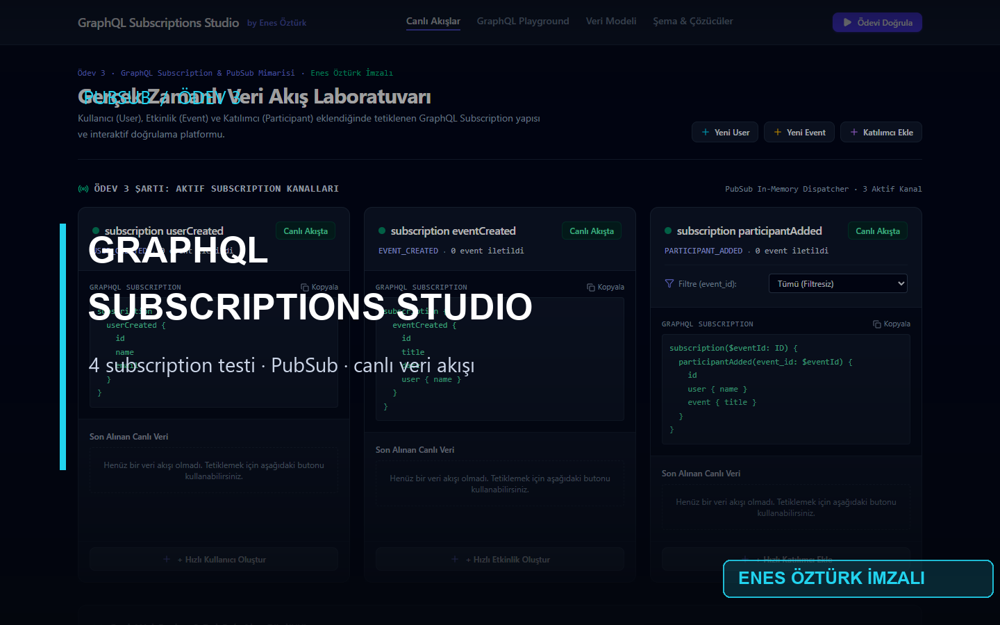
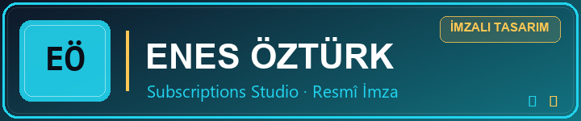
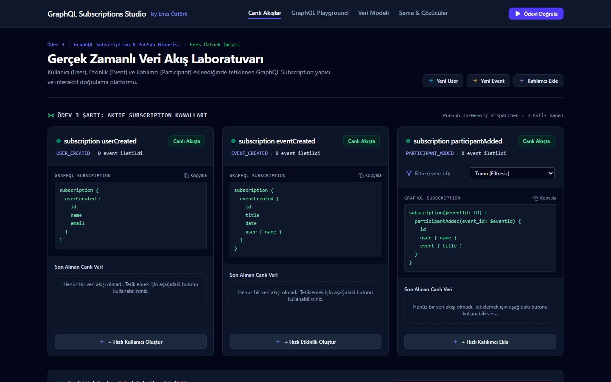
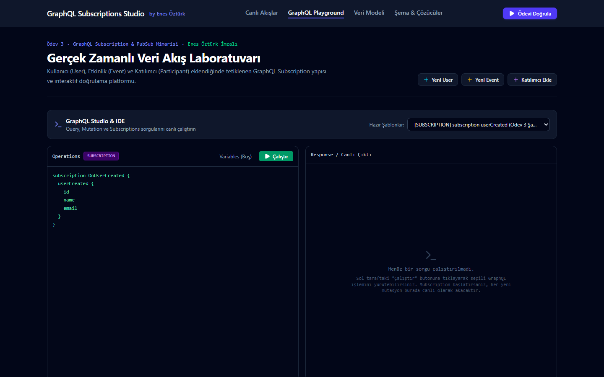
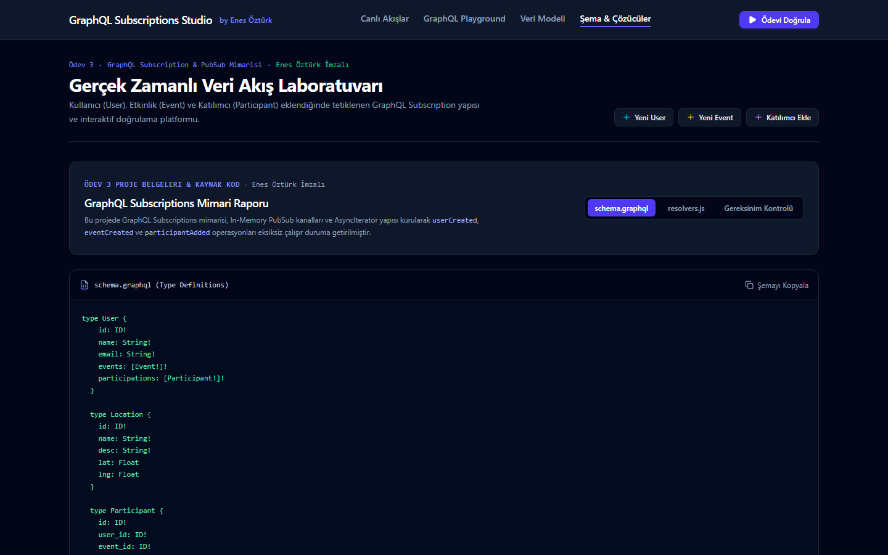

<div align="center">



# GraphQL Subscriptions Studio

**Ödev 3 — tarayıcı içi PubSub, dört subscription testi ve canlı veri akışı içeren GraphQL stüdyosu.**

[](https://github.com/EnesBinMalik/graphql-subscriptions-studio)
[](https://github.com/EnesBinMalik/graphql-subscriptions-studio)
[](https://github.com/EnesBinMalik/graphql-subscriptions-studio)
[](https://github.com/EnesBinMalik/graphql-subscriptions-studio)
[](https://github.com/EnesBinMalik/graphql-subscriptions-studio)
[](https://github.com/EnesBinMalik)



</div>

---

## Hakkında

Bu stüdyo, GraphQL Subscription mekanizmasını harici bir sunucu olmadan gösterir. Tarayıcı içi PubSub motoru userCreated, eventCreated ve participantAdded olaylarını yayınlar; dört doğrulama testi aboneliklerin doğru çalıştığını kanıtlar. Canlı akış paneli olayları anında görüntüler.

> Bu proje **Enes Öztürk** tarafından tasarlanmış, geliştirilmiş ve imzalanmıştır.

---

## Öne çıkan özellikler

| Özellik | Açıklama |
| --- | --- |
| **4 subscription testi** | Aboneliklerin doğruluğunu otomatik denetler. |
| **PubSub motoru** | Tarayıcı içinde olay yayını ve abonelik. |
| **Canlı akış** | Olayları anlık olarak listeler. |
| **Hızlı oluşturma** | Tek tıkla kullanıcı, etkinlik ve katılımcı ekleme. |
| **GraphQL Playground** | Mutation ve subscription sorgularını çalıştırma. |
| **Şema & çözücüler** | Tiplerin ve resolver'ların görsel dökümü. |

---

## Doğrulama

| Ölçü | Değer |
| --- | --- |
| Test | 4 |
| Olay | 3 tip |
| Motor | PubSub |
| Sunucu | Gerekmez |

---

## Galeri







---

## Kurulum

**Gereksinim:** Node.js 20+

```bash
git clone https://github.com/EnesBinMalik/graphql-subscriptions-studio.git
cd graphql-subscriptions-studio
npm install
npm run dev
```

> Tüm akış istemci tarafında çalışır; ek sunucu kurulumu gerekmez.

Diğer komutlar:

```bash
npm run build     # Üretim derlemesi
npm run preview   # Derlemeyi önizle
npm run lint      # TypeScript tip kontrolü
```

---

## Teknik mimari

```text
src/graphql/pubsub.ts       Tarayıcı içi olay motoru
src/graphql/schema.ts        Şema ve resolver'lar
src/graphql/executor.ts      Sorgu çalıştırıcı
src/components/LiveStreamFeed.tsx  Canlı akış
src/components/VerificationModal.tsx  Test sonuçları
```

---

## İmza

<div align="center">

[](https://github.com/EnesBinMalik)
[](https://github.com/EnesBinMalik)

**Bu kod, tasarım ve deneyim Enes Öztürk'ün kişisel imzasını taşır.**

© 2026 Enes Öztürk — Tüm hakları saklıdır.

</div>
